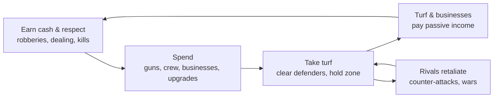

# Street Law: Game Design Document

> Living document. Update it whenever a design decision changes.

## 1. Vision

**Street Law** is a 3rd-person open-world gang warfare game in the spirit of *Saints Row 1 & 2* and the classic 3D-era *GTA* games. You start with nothing: one corner, a handful of friends and an empty wallet. You build a crew, take the city district by district, and run a criminal empire. That means robberies, drive-bys, trap houses, drug operations, front businesses and an arsenal, until every block flies your colors.

**Tone:** over-the-top, arcade-y and funny-gritty, closer to Saints Row 2 than GTA IV. Systems come first and story second, but the story should give the climb from the gutter some character.

## 2. Design pillars

1. **Your turf, visibly.** Territory ownership is the spine of the game. You should always see your progress on the map, the streets and the income.
2. **The crew is the character.** Your gang members are the resources you manage and the bodies at your side. Recruit them, arm them, assign them to jobs and lose them.
3. **Chaos is a tool.** Driving, shooting and explosions are fun on their own, and you should rarely need a mission to start having fun.
4. **Every dollar buys power.** Money flows into things that open up new gameplay (businesses, weapons, vehicles, upgrades), not just bigger numbers.

## 3. Core loop

- **Moment-to-moment:** run, drive, shoot, steal cars, fight rivals and the police.
- **Session:** pick an activity (a robbery, a turf war, a drug run), cash out, invest.
- **Long term:** take all districts and all three rival gangs' leadership, which ends the campaign. Free roam continues afterwards.

## 4. Player & controls (PC first, gamepad later)

| Action | Default |
| --- | --- |
| Move / sprint / jump | WASD / Shift / Space |
| Camera | Mouse (over-the-shoulder orbit) |
| Shoot / aim | LMB / RMB |
| Weapon wheel | Hold Q (game pauses), aim with mouse, release to equip |
| Switch weapon / reload | Mouse wheel or 1-9 / R |
| Throw / launch explosive | LMB with grenade, molotov, C4 or RPG equipped |
| Detonate placed C4 | G |
| Enter / steal / exit vehicle | E |
| Handbrake (in vehicle) | Space |
| Drive-by (in vehicle) | LMB with the equipped gun (mouse looks around) |
| Map | Tab / M |
| Release mouse | Esc |

- **Health** regenerates slowly once you've avoided damage for a few seconds. Taking hits flashes the screen red. Death means "Wasted": a hospital bill (a percentage of cash) and a respawn at your hideout.
- Later: cover, lock-on aim option, melee, swimming, carrying bodies or loot.

## 5. Systems

### 5.1 Territories & gang warfare ✅ *(prototype)*
- The city is split into **districts**, each owned by a gang (or unclaimed).
- *Planned hierarchy (#24):* the city is made of **areas**, each with several **districts**. Each district has a **safehouse**: take the safehouse to take the district, and take every district to take the area. Owned safehouses are where you **manage your gang and buy upgrades** (#25).
- **Enterable buildings** *(prototype, #26):* every district has buildings placed on city lots. Corner stores, bars, homes, rival fronts and an informant's flat each show a door prompt.
  - **Rob:** empty the register or break in. The building is marked robbed and refills over time.
  - **Take out:** clear the armed guards inside a rival front. This pays cash and respect, and the front stays closed.
  - **Talk:** persuade, intimidate (needs a drawn gun) or pay people. This gets you intel (marks rival fronts on the map, or safehouse leads), recruits for your crew, favours, or a quiet register squeeze. Odds depend on respect, weapon, turf and how the person feels about you. Failing can raise heat.
- **Capture:** kill every defender in the district, then stay inside on foot until the capture bar fills.
- Owned districts pay **income every cycle** (30 s in the prototype) and give **respect**.
- *Next:* rival **counter-attacks** on your turf, **turf wars** (wave defense), **strongholds/bosses** per gang, district **heat**, and capturing **sub-zones** (blocks or hotspots) instead of whole districts.

### 5.2 Rival gangs
| Gang | Color | Home turf | Flavor |
| --- | --- | --- | --- |
| **Street Law** (player) | Purple | The Bottoms | Your crew, from the gutter up. |
| **Red Vipers** | Red | Rail Yards, Eastside | Street-level, numerous, cheap guns. |
| **Eastside Kings** | Gold | Midtown, Northgate, Hillcrest | Flashy, well-armed, love cars. |
| **Harbor Syndicate** | Blue | Old Harbor, Downtown, Riverside | Organized crime, money and heavy weapons. |

Each gang should have its own visual style, vehicles, weapons, AI behaviour and a story arc that ends with taking down its leadership.

### 5.3 Crew management
- **Recruit** gang members using respect and cash. Each member has skill, loyalty and a role.
- **Assign** them: follow me (homies, up to 3 at once), **dealing** in a territory, **guarding** a trap house or business, or **crew jobs**.
- Members can be killed or arrested, and they level up with use.

### 5.4 Drug operations & trap houses
- **Find a plug** (supplier) to unlock each drug. Without a plug you can't produce it (#27).
- **Take over trap houses** (an assault mission) to unlock production in that district.
- **Manufacture** product (it takes time and supplies) and **assign dealers** to territories. Income scales with district demand, product quality and dealer skill.
- Risk: police raids and rival hits on your operations. Defending them is a mission type.

### 5.5 Robberies & heists
- **Houses:** stealth/smash-and-grab with loot carried back to a vehicle and fenced.
- **Businesses:** hold-ups (intimidate the clerk, the register cash grows with time, wanted level).
- **Banks:** multi-stage heists: plan, gear up, crew, vault, getaway.

### 5.6 Businesses
Buying businesses unlocks features and pays income:

| Business | Unlocks |
| --- | --- |
| Chop shop / garage | Vehicle storage, respray, upgrades |
| Gun store | Weapon and ammo purchases, attachments |
| Clothing store | Gang colors and player customization |
| Nightclub | Laundering (boosts income), recruitment |
| Pawn shop | Fencing stolen goods |
| Hideouts / cribs | Respawn point, save point, crew HQ |

### 5.7 Weapons & explosives
Pistols, SMGs (drive-by capable), shotguns, rifles, plus grenades, molotovs, pipe bombs, C4 and RPGs. Weapons are data-driven (`WeaponData` resources in `data/weapons/`) so new guns are content, not code. Arsenal expansion: #28.

✅ *Prototype:*
- **Inventory and weapon wheel:** fists, pistol, SMG, shotgun (pellets) and assault rifle. The wheel pauses the game while it's open.
- **Ammo:** magazine and reserve ammo, manual and automatic reload, pickups, and weapons dropped by dead rivals.
- **Explosives:** grenades (bounce, 2.5 s fuse), molotovs (fire area that burns for a few seconds), sticky remote C4 (G to detonate) and RPGs (explode on impact). Blasts fall off with distance, need line of sight, push vehicles and shake the camera.
- **Rival arsenals:** each rival gang carries its own mix of weapons. NPCs fire in bursts with reduced damage, get alerted when shot, and flash when hit.

### 5.8 Vehicles
Stealable cars, trucks, bikes and gang-specific rides. Garage storage, upgrades (engine, armor, nitro, bulletproof tires) and damage that ends in explosions. Drive-bys from any seat. ✅ *Prototype: drivable cars, stealing, drive-by, running over NPCs, and vehicle health: bullets, blasts and hard crashes damage cars, which smoke, then burn, then explode (ejecting the driver and damaging anything nearby). Rivals shoot at your car while you drive.*

### 5.9 Police & heat
A wanted level from 1 to 5 stars that escalates from cops to SWAT to the military. It's driven by crimes witnessed. Lose it by hiding, respraying or paying off.

### 5.10 World
- One city map with 9+ districts, each with its own identity (industrial, harbor, downtown, suburbs, projects).
- Civilians, traffic and day/night cycle, plus a weather pass later.
- Prototype: a procedurally laid-out grid city (`CityGenerator`), to be replaced by a hand-authored, streamed map.

### 5.11 Progression & economy
- **Cash** buys things. **Respect** gates story missions, recruitment and unlocks (Saints Row style).
- Income sources: turf, dealing, businesses, robberies, side activities.
- Money sinks: weapons, ammo, crew upkeep, businesses, vehicles and upgrades, bribes and hospital bills.

## 6. Missions & content (later)
- Story missions per rival gang (3 arcs) plus a final act.
- Repeatable activities: turf wars, robberies, deliveries, races, assassinations and "insurance fraud"-style mayhem activities.

## 7. Technical direction
- **Engine:** Godot 4 (GDScript), Forward+ renderer. See [ARCHITECTURE.md](ARCHITECTURE.md).
- **Target:** Windows PC first, then Linux/Steam Deck. Gamepad support before any console talk.
- **Art:** greybox until the core loop is fun, then stylized low/mid-poly assets.

## 8. Milestones
1. **M0: Foundation** ✅ project, controller, vehicles, territories, HUD/minimap, tests
2. **M1: Combat & AI**: weapons, ammo, explosives, better NPC AI, police heat
3. **M2: Gang & Turf**: crew, homies, counter-attacks, turf wars, rival strongholds
4. **M3: Economy**: businesses, shops, trap houses, drug operations, robberies
5. **M4: World**: hand-built city, traffic, pedestrians, day/night, save/load
6. **M5: Content**: missions, story arcs, audio, art pass
