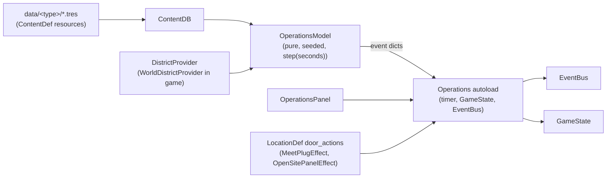

# Operations framework

Drug manufacturing (#27) is the first user of a reusable **operations** framework: items and stashes, crew
jobs at sites, production recipes, sales into districts, suppliers ("plugs") and risk events. Trap houses
(#14), businesses (#11), crew jobs (#10) and fencing (#15) are meant to be built on the same pieces.

## Architecture

- **`OperationsModel`** (`RefCounted`) owns all runtime state and simulation rules. It has no node, scene
  or autoload dependencies beyond an injected content lookup, district provider, cash callables and
  crew list. `step(seconds)` advances the simulation and returns event dictionaries. A single long step
  gives the same result as many short ones, so off-screen or offline time costs one call.
- **`Operations`** (autoload) builds the model from `ContentDB`, `GameState` and the live territories. It
  calls `step(tick_seconds)` on a timer (2 s by default; there is no per-frame work), applies cash and income
  to `GameState`, and re-emits each event on `EventBus`.
- **Behaviour is pluggable.** What a job *does* is a `JobBehavior` resource, sale prices come from a
  `PricingModel`, gating uses the shared `Condition`, and consequences use the shared `Effect`. Content
  picks and configures these in the inspector, so no code is needed for new variants.

## Content (data/&lt;type&gt;/)

| Folder | Class | Purpose |
| --- | --- | --- |
| `items/` | `ItemData` | Commodity: category, `base_value`, `heat_per_unit`, `icon_path`, `visual: VisualSpec`. |
| `recipes/` | `RecipeData` | `inputs`/`outputs: Array[ItemStack]`, `cycle_seconds`, `required_unlocks`, `site_tags`, `skill_speed_bonus`. |
| `jobs/` | `JobData` | `skill`, `behavior: JobBehavior`, `conditions`, `risks`, `heat_per_cycle`, `xp_per_cycle`. |
| `sites/` | `SiteData` | `kind`, `district_id`, `location_id`, `allowed_jobs`, `max_workers`, `stash_capacity`, `acquire_price`, `starts_acquired`, `acquire_conditions`, `operate_conditions`, `risks`, `visual`. |
| `plugs/` | `PlugData` | `location_id`, `reveal_conditions`, `requires_meeting`, `buy_in_price`, `grants_unlocks`, `supplies`, relationship tuning, `visual`. |
| `markets/` | `MarketProfile` | Per-district `demand` multipliers and saturation tuning. `default` is the fallback. |
| `risks/` | `RiskData` | `chance_per_minute`, `heat_multiplier`, `guard_mitigation`, `effects: Array[Effect]`, `notify_text`. |
| `crew/` | `CrewMemberData` | Crew definitions; `starter = true` joins the gang at the start. |

Every class extends `ContentDef` (`id`, `display_name`, `description`, `tags`), so `ContentDB.validate()`
checks them. Cross-references are ids, never `res://` paths. Visuals are a `VisualSpec`, which loads a
scene or mesh by path and falls back to a greybox shape.

### Adding content (no code)

- **New drug:** add an `ItemData` (category `drug`), a `RecipeData` that outputs it with
  `required_unlocks = [drug:<id>]`, and a `PlugData` with `grants_unlocks = [drug:<id>]` that supplies its precursor.
  Then add demand for it to the `MarketProfile`s.
- **New site:** add a `SiteData` with a `district_id`, tags that match its recipes (`grow`, `lab`...),
  `allowed_jobs`, and `DistrictOwnedCondition` as an operate condition. Point `location_id` at a unique `LocationDef`.
- **New risk:** add a `RiskData` and give it effects (`SeizeStockEffect`, `ArrestCrewEffect`, `StealCashEffect`,
  `PlugRelationshipEffect`, or any core `Effect`). List it on a site or job.
- **Swap an asset:** change the `VisualSpec` on the resource. Swap a behaviour by changing the
  job's `behavior`, or the `pricing` on a `SalesBehavior`.

### Extending (code)

- **New kind of work** (laundering, fencing, smuggling): subclass `JobBehavior` and override
  `validate`, `tick`, `describe`, `risk_mitigation` and `param_options`. Change state only through
  `JobContext` (`stash`, `param`, `take`, `give`, `pay`, `add_heat`, `skill`, `set_status`, `complete_cycle`).
- **New pricing:** subclass `PricingModel.unit_price(item, market, saturation, seller_skill)`.
- **New gate/consequence:** subclass the core `Condition` (`_evaluate`/`_reason`), `Cost`
  (`_can_pay`/`_pay`) or `Effect` (`_apply`). Simulation keys are read from `ctx.vars`
  (`model`, `site_id`, `crew_id`, `district_id`, `assignment`).
- **Different territory source:** subclass `DistrictProvider` (`owner_of`, `display_name`, `all_districts`).

## Public API

### `Operations` (autoload)

| Member | Notes |
| --- | --- |
| `model: OperationsModel` | Live simulation. Query/mutate it directly; mutations emit events on the next `apply_events()`. |
| `tick_seconds`, `report_seconds` | Simulation tick and income-summary interval. |
| `simulate(seconds)` | Advance immediately (catch-up, debug, tests). |
| `refresh()` | Re-evaluate plug reveals and site conditions (e.g. after a district changes hands). |
| `apply_events(events)` | Applies model events to GameState and EventBus. |
| `open_overview()`, `open_site_panel(site_id)`, `open_plug_panel(plug_id)` | Management UI. |
| `to_dict()`, `from_dict(data)` | Plain-dictionary, JSON-safe state for #19 save/load. |

### `OperationsModel` (main calls)

Most actions return `""` on success or a player-facing reason; `can_*` checks without acting.

- Sites: `site_ids()`, `is_site_acquired(id)`, `can_acquire_site(id)`, `acquire_site(id)`,
  `site_stash(id) -> Inventory`, `site_heat(id)`.
- Jobs: `available_jobs(site)`, `available_recipes(site)`, `can_assign(crew, site, job, params)`,
  `assign(...) -> JobAssignment`, `unassign(id)`, `unassign_crew(crew)`, `assignments_at(site)`, `describe(a)`.
- Plugs: `plug_ids()`, `is_plug_revealed(id)`, `meet_plug(id)`, `can_establish_plug(id)`, `establish_plug(id)`,
  `plug_price(plug, item)`, `buy_supplies(plug, item, amount, site)`, `plug_relationship(id)`.
- Unlocks: `has_unlock(id)`, `grant_unlock(id)`, `unlocks()`.
- Markets: `market_for(district)`, `quote(district, item, skill)`, `record_sale(...)`.
- Crew: `add_crew(member)`, `crew(id)`, `jail(crew, seconds)`, `jail_time_left(crew)`.
- Simulation: `step(seconds) -> Array[Dictionary]`, `drain_events()`, `to_dict()`, `from_dict(data)`.

### Data actions (used by `LocationDef.door_actions` / `InteractionAction`)

`MeetPlugEffect{plug_id}`, `OpenSitePanelEffect{site_id}`, `GrantUnlockEffect{unlock_id}`,
`GiveItemEffect{item_id, amount, site_id}`, `ItemCost{item_id, amount, site_id}`. Conditions:
`UnlockCondition`, `DistrictOwnedCondition`, `SiteAcquiredCondition`, `CrewStatusCondition`.

### EventBus signals

`operations_event(event)` (every event, raw), `stash_changed`, `site_acquired`, `job_assigned`,
`job_unassigned`, `job_status_changed`, `production_completed`, `sale_completed`, `unlock_granted`,
`plug_revealed`, `plug_established`, `plug_relationship_changed`, `operation_risk`.

## Save state

`Operations.to_dict()` stores sites (acquired, heat, stash), assignments, unlocks, plug state, market
saturation, jail timers and the RNG state. Crew members (skills, xp, status) belong to `GameState.crew` and
are saved with it. `from_dict()` re-runs `setup()`, so content added after a save appears automatically.

## Tests

`tests/operations_tests.gd` (run from `tests/run_tests.gd`) covers inventory, content validation, plug gating,
production, district loss, sales and saturation, assignment rules, risk, plug pricing, save/load determinism
and the autoload/panel wiring. Tests build isolated models with a fixed seed and a dictionary `DistrictProvider`.
