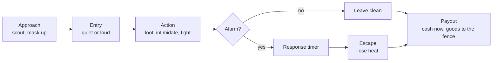

# Hit loop: core gameplay mechanics
Every hit follows the same loop. Burglaries, hold-ups, targeted thefts, raids, interrupts, intercepts and jacks are variations of it.
This doc covers how hits play: what the player does, sees, and risks moment to moment. *What* exists is in `HIT_LOCATIONS.md` and `NORTH_END_HITS.md`.

## Decisions (user)
- **Two viable styles.** Going quiet gets more loot and less heat. Going loud is faster but riskier.
- **Hold-to-act interactions:** hold E and a progress bar fills. Tools make it faster. There are no minigames.
- **Witnesses** run and phone the cops. You can stop them by intimidating them.
- **Masks** reduce the heat tied to you, but wearing one in public draws attention.
- **Alarms start a visible response timer.** Cops arrive when it hits zero. No instant wanted level.
- **Shop hold-ups can trip a silent alarm.** It runs a hidden timer, and you read the clerk's tells instead of a HUD.
- **Time of day matters.** Occupancy, cash amounts and guard shifts change over the day.

## The loop

### 1. Approach
- **Scout:** looking at a target (aim plus a hold button, or binoculars later) shows its info card:
  - occupants
  - cash estimate (from tips, or vague without one)
  - alarm (yes, no, or unknown)
  - guards
  - best time to hit
- **Mask up:** the mask toggle takes 1 s. While masked:
  - Witnesses report "a masked man", so **heat is ×0.5 and no clout loss is tied to you**.
  - Cops and passersby notice a mask on the street. Leaving it on outside a hit raises **suspicion**.
- **Time of day:**
  - Houses: empty during work hours (9–5), occupants asleep at night (quiet works, but noise wakes them).
  - Shops: open hours mean customers (witnesses) and a full register. Closing time (21–23) means the most cash and few witnesses. Closed means a burglary only, with an alarm.
  - Bank: business hours only, with a guard.

### 2. Entry
| Method | Time | Noise | Notes |
|---|---|---|---|
| Walk in (open shop) | 0 | None | Start a hold-up from inside |
| Lockpick door/window | 4 s (2 s with a pick set) | Quiet | Hold E |
| Kick door / smash window | 0.5 s | **Loud** | A noise ping of radius 15 m |
| Back door / side window | Varies | Quiet | Each interior template has 1–2 alternate entries |
| Breach (raid) | 1 s | Very loud | Rival guards are alerted instantly |

### 3. Action
**Noise** is the main stealth stat:
- Each action makes a noise ping with a radius.
- NPCs inside the radius go *suspicious* (they investigate), then *alerted*.
- Guns are loud unless suppressed; a suppressor can be bought from the gun store later.

**Burglary**
- **Searching:** containers (drawers, closets, safes) are hold-E, 1–3 s each. Each has a loot table.
- **Carry limit:** 4 goods slots, where small items count as 1 and a TV counts as 2. The car trunk holds 8 more, so you can make several trips.
- **Sleeping occupants:** noise wakes them, and they either flee to call the cops or fight back if armed.

**Hold-up**
- **Intimidation meter:** aim at the clerk and it fills. It fills faster with a bigger gun, crew present, or a mask.
- **Bagging:** once the clerk complies, they bag the register (5 s). During that time:
  - If you lower your aim, the meter drains.
- **Silent alarm.** Every staffed shop, the bank and the pawn shop have a panic button under the counter.
  - **When it can trigger:** the clerk can press it at any point during the hold-up: on entry, while bagging, or after you look away.
  - **Chance:** the base chance is 25%, rolled at the start of the hold-up. It drops with a high intimidation meter, a mask, or a bigger gun. It rises if you lower your aim, take too long, or the shop has been hit recently. The bank's chance is 60%.
  - **It's silent:** there's **no HUD timer or sound**. A **hidden response timer** starts instead.
  - **Tells** you can spot: the clerk's hand dips below the counter, their eyes flick to the door, and they bag slowly. A tip or scouting (target card shows "panic button: yes/no") also reveals it.
  - **Counter:** keep the clerk's hands visible (stay aimed, and move them away from the counter with the "Step back!" prompt). Or own the business, since your own businesses can't be robbed anyway.
  - **Reveal:** the timer turns visible (with a sting) when the first cop siren is in earshot, about 10 s before they arrive. If you rushed, you're fine. If you went for the back-room safe, you might not be.
- **Back-room safe:** optional, hold-E for 8 s (4 s with a drill). It roughly doubles the take.
- **Customers** are witnesses. Aiming at them keeps them down.

**Targeted theft**
- **The target item has a marker** if you got a tip; without one you have to search.
- It's often in a locked room or display case, which is loud to smash or quiet to pick.

**Raid (rival trap / front / stash)**
- **Fight through rival guards.** There are 2–3 waves, and reinforcements arrive in 60 s if they called for them.
- **To finish:** clear the house, then **hold the stash room for 20 s** (a capture ring).
- **Then choose:**
  - **take over:** it becomes your trap house
  - **torch:** a 5 s fire, which destroys it
  - **loot and leave**

**Interrupt (deal) / intercept (van) / jack (car)**
- **Interrupt:** the deal is a short timed window (2–4 min game time). Ambush or snipe it. The dealers flee by car, so it can turn into a chase.
- **Intercept:** the van follows its route. Disable it by shooting tires, ramming, or blocking it with a car. Then **hold the doors open (6 s)** while the guards fight back.
- **Jack:** reach the car. There's a quiet option (lockpick 4 s, with a car alarm chance) and a loud one (smash the window, instant alarm). Deliver it to the chop shop **undamaged** for full pay; damage lowers the payout.

### 4. Alarm & witnesses
**What triggers the alarm:**
- a tripped alarm system (closed shops, some houses)
- a silent alarm (hold-up)
- a witness who finishes the phone call
- gunfire heard by a civilian outside

**Witnesses:**
- A witness runs, then pulls out a phone. The **phone call takes 5 s** (a visible icon).
- You can stop the call by **intimidating** them: aim at them in range, which makes them drop and cower. A cowering witness doesn't call, but walk away and they will.
- Killing a witness also stops the call, but it's a big heat spike and costs **clout** in that district.

**Response timer:**
- It's a visible countdown for loud alarms and witness calls. **Silent alarms run it hidden** until about 10 s before arrival (see Hold-up). The base time depends on the district's police presence: 60 s in poor districts, 45 s in average ones, 30 s in rich ones. Higher heat shortens it.
- When it ends, cops arrive at the scene and **wanted level 1** begins if you're still inside the search zone.

### 5. Escape & heat
- **Wanted levels (1–5) when the timer ends:**
  1. a patrol car
  2. several units
  3. a roadblock and a helicopter
  4. SWAT
  5. heavy response

  Hit size and violence set the starting level.
- **Search zone:** a circle around the last place you were seen. Leave it and stay unseen for 20–40 s to lose the wanted level.
- **Breaking line of sight:** swapping cars or taking off the mask while unseen makes it faster.
- **Lay low:** a safehouse instantly clears level 1–2. Your own districts give a faster search-zone cooldown, and the clout perk comes later.
- **Heat** (persistent, per district) is separate from the wanted level. Every hit adds heat. High district heat means more patrols and shorter response timers, and it fades over in-game days.

### 6. Payout
- **Cash** is credited instantly.
- **Hot goods:** sell them to a fence (pawn shop, 40%, or 70% if you own it), stash them at the safehouse, give cars to the chop shop, or use drug inputs in your operation.
- **Fail** (killed or arrested): lose the hot goods you're carrying plus a cash deduction (already decided).
- **Clout:** applied when you finish, per the own-turf rule.

## Quiet vs loud: same target, two runs
| | Quiet (burglary at night) | Loud (kick in, hold-up) |
|---|---|---|
| Time | 2–3 min | 30–60 s |
| Loot | Full search: +50% | Register only, plus safe if there's time |
| Alarm | Only if you're noisy | Almost certain |
| Heat | Low | High |
| Risk | Waking occupants | The timer, cops |

## UI surfaces needed
- **Target info card** (when scouting).
- **A progress ring** on hold-E actions.
- **Noise:** a noise ripple when an action is loud.
- **NPC state icons:** ? suspicious, ! alerted, 📞 calling.
- **Hold-up:** the intimidation meter and the bagging bar.
- **The response timer,** top-center.
- **Wanted:** stars plus the search-zone circle on the minimap.
- **Carry slots** next to the HUD cash.

## Framework hooks (when built)
- **HitSession:** a new runtime object per active hit. It tracks entry method, noise, alarm state, timer and loot carried, and ends in success, fail or abandon.
- **NoiseEmitter / Perception** on NPCs: a reusable suspicion → alert state machine. It's also used by guards in Operations.
- **WitnessBehavior:** flee → call → report. Can be interrupted by intimidation.
- **ResponseTimer and a Wanted service.** These replace or extend the current heat effect. District heat stays in `Turf`/`GameState`.
- **HoldInteraction:** the generic hold-E action, with tool-based speed modifiers. It extends the existing `InteractionAction`.
- **Existing actions** (`rob_register`, `smash_and_grab`, `enter_building`) are migrated onto HitSession.

## Further decisions
1. **Witnesses can be killed.** It causes a big heat spike and costs clout in that district.
2. **Crew on hits** is deferred to the crew-in-the-field plan. For now, hits are solo.
3. **Wanted level is capped at 3 in North End** (no SWAT or heavy response). Levels 4–5 unlock in later zones.