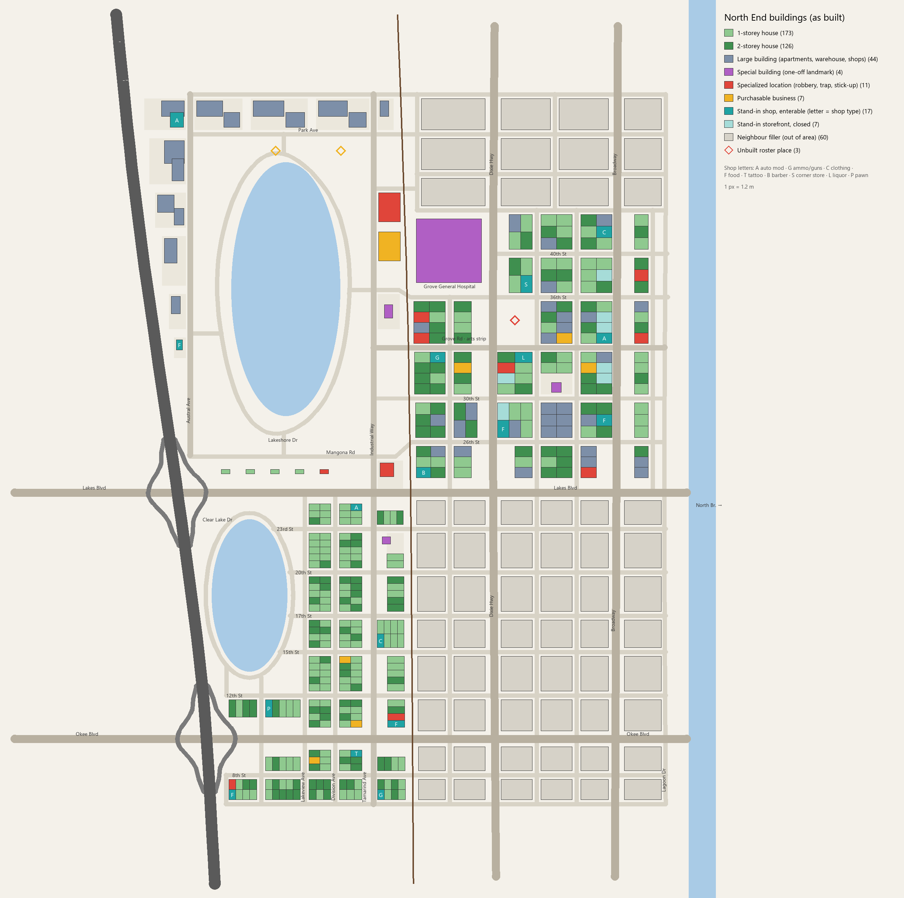

# North End building census

Step 1 of the building pipeline: **census → design the building types → rescale the map → populate → playtest**.
This doc and its data list every building in the North End, assign each one a category and a design archetype (the
unique building design it needs), and note where the current map is too small for SCALE.md-correct buildings.

| What | Where |
|---|---|
| Census data (load this from map-population code) | `data/areas/north_end_buildings.json` |
| Builder, category rules, archetype table | `scripts/world/north_end_census.gd` (`NorthEndCensus`) |
| Regenerate the census | `Godot --headless --path . res://tools/north_end_census.tscn` |
| Coverage + freshness test | `tests/census_tests.gd` (runs in `res://tests/test_runner.tscn`) |
| As-built building map | `docs/map/north_end_buildings.png` / `.svg` (`python tools/render_north_end_buildings.py`) |
| Census on the wireframe | `docs/map/north_end_wireframe.png` / `.svg`: generated `census-overlay` + `census-legend` groups (same script) |



## Census format

`buildings[]` holds one entry per building box in the live scene, plus the three player safehouses. Each entry has:

| Field | Meaning |
|---|---|
| `id` | Stable id `ne_<tr/ng/mg>_<street>_<nn>`, numbered north to south and then west to east along the street |
| `key` | Scene match key: lot rect (`"x,y,w,h"` px) or `safehouse:<district>` |
| `position_m`, `yaw_deg` | Footprint centre (world X/Z) and the door's facing toward the street |
| `footprint_m`, `height_m`, `current_storeys` | The current greybox box |
| `lot_m`, `lot_frontage_depth_m`, `rect_px` | Current lot: map-axis size (x, y) in m, frontage × depth in m (compare with archetype `lot_m`), rect in wireframe px |
| `district`, `street`, `street_kind`, `block` | Where it is. `street` is the frontage street; `block` is the city-generator block index |
| `category` | One primary category (see below) |
| `tags` | Secondary categories and traits, e.g. a trap house in a 2-storey house carries `house_2f` |
| `roles` | Gameplay roles: `robbery` (event, tier), `stick_up`, `trap_house` (T1–T3), `business` (type, purchasable, price, income), `raid`, `safehouse`, `turf_point`, `plug_meet`, `informant`, `tip_source` and others |
| `design_archetype` | Key into `archetypes` (and `NorthEndCensus.ARCHETYPES`): the design this building needs |
| `name`, `roster`, `location` | Roster names / numbers from NORTH_END_HITS.md and the placed `Location` |

Other top-level lists:
- `out_of_area[]` lists the 60 neighbour filler boxes on the Riviera / Clement off-blocks. They are scenery for neighbouring areas and are not designed here.
- `unbuilt[]` lists roster places whose door currently stands on open ground with no building box (see below).

## Counts

| Category | Count | Notes |
|---|---:|---|
| `house_1f` | 173 | 117 Tamarack Row, 52 Northgrove, 4 Mangona trailers |
| `house_2f` | 126 | 71 Tamarack Row, 55 Northgrove |
| `large_building` | 44 | 29 walk-ups and 1 mixed-use (Northgrove); 9 sheds and 5 warehouses (Mangona) |
| `special_building` | 4 | Hospital + 3 safehouses |
| `specialized_location` | 11 | +1 unbuilt (bank) |
| `purchasable_business` | 7 | +2 unbuilt (gun store, hardware store) |
| `standin_business` | 24 | 17 enterable shops + 7 closed storefronts (see [Stand-in businesses](#stand-in-businesses)) |
| **North End total** | **389** | + 60 out-of-area fillers = 449 scene boxes; + 3 unbuilt |

Roughly 300 placer houses (`house_*`) are robbable burglary targets; the robbery tier comes from the archetype `tier`.

## Archetypes to design (42)

**Shared archetypes (13).** Many buildings reuse each one. The house archetypes line up with the 15 one-floor and 10
two-floor house exterior scenes being built (1f/2f × small yard / big yard / deep lot). Each archetype should ship
in several variants (colour, roof, porch, mirrored).

| Archetype | Cat. | Storeys | Footprint m | Lot m | Tier | Count |
|---|---|---:|---|---|---|---:|
| `house_1f_small_yard` | house_1f | 1 | 14 × 11.2 | 18 × 22 | low | 117 |
| `house_1f_big_yard` | house_1f | 1 | 19.6 × 14 | 26 × 30 | medium | 39 |
| `house_1f_deep_lot` | house_1f | 1 | 14 × 11.2 | 18 × 40 | low | 13 |
| `house_2f_small_yard` | house_2f | 2 | 14 × 11.2 | 18 × 22 | medium | 76 |
| `house_2f_big_yard` | house_2f | 2 | 19.6 × 14 | 26 × 30 | high | 46 |
| `house_2f_deep_lot` | house_2f | 2 | 19.6 × 14 | 24 × 42 | medium | 4 |
| `trailer_1f` | house_1f | 1 | 16 × 4.5 | 14 × 24 | low | 4 |
| `storefront_1f` | large | 1 | 20 × 16 | 24 × 30 | – | 0 (all became stand-ins; kept for new lots) |
| `mixed_use_2f` | large | 2 | 22 × 16 | 24 × 28 | – | 1 |
| `apartment_walkup_3f` | large | 3 | 28 × 20 | 34 × 36 | – | 29 |
| `industrial_shed` | large | 1 (6 m eaves) | 24 × 18 | 30 × 32 | – | 9 |
| `warehouse` | large | 1 (8 m eaves) | 40 × 30 | 50 × 48 | – | 5 |

**Stand-in archetypes (5)**, shared by the stand-in businesses. They must read as shops, not houses: flat roof or parapet, a full-width glazed shopfront, a sign band over the door, and pavement out to the kerb. Each enterable one needs a 1.2 × 2.4 m door (double door for garage-bay offices) and an interior counter. Closed ones get the same shell with shutters or papered glass.

| Archetype | Storeys | Footprint m | Lot m | Used for | Count |
|---|---:|---|---|---|---:|
| `standin_strip_unit` | 1 | 20 × 16 | 24 × 30 | Strip-mall unit on an arterial (Tamarack Okee Blvd) | 2 |
| `standin_shopfront_2f` | 2 | 22 × 16 | 24 × 28 | Shop with a flat above (Northgrove Broadway / Dixie / Lakes) | 11 |
| `standin_standalone_shop` | 1 | 16 × 14 | 20 × 28 | Freestanding shop on a corner or a shed lot | 5 |
| `standin_corner_store` | 1 | 14 × 12 | 18 × 24 | Corner shop at a residential crossing | 3 |
| `standin_garage_bays` | 1 (5 m bays) | 24 × 18 | 30 × 36 | Auto mod shop: 2–3 roll-up bays and a forecourt | 3 |

`neighbour_filler` (60) is a placeholder archetype for the out-of-area boxes and is not designed here.

**One-offs (24).** Each of these needs its own design.

| Archetype | Building | Cat. | Footprint m | Lot m | Roles |
|---|---|---|---|---|---|
| `grove_general_hospital` | Grove General Hospital | special | 100 × 96, 7 st. | 110 × 110 | landmark, plug contact P2 |
| `safehouse_duplex` | Tamarack Row safehouse | special | 14 × 12, 2 st. | 24 × 26 | safehouse, turf point |
| `safehouse_warehouse` | Mangona safehouse | special | 22 × 14, 2 st. | 30 × 34 | safehouse, turf point |
| `safehouse_greybox` | Northgrove safehouse | special | 10 × 10 | 24 × 26 | safehouse, turf point (needs a real design) |
| `trap_house_the_spot` | The Spot | specialized | 14 × 11.2 | 18 × 30 | rival trap T1, raid |
| `stash_house_viper` | Viper Stash House | specialized | 19.6 × 14, 2 st. | 26 × 30 | raid, ledger theft |
| `stash_house_grove` | Grove Stash House | specialized | 19.6 × 14, 2 st. | 26 × 30 | trap house T2, drug lab |
| `trap_trailer_lakeside` | Lakeside trailer | specialized | 16 × 4.5 | 14 × 24 | trap house T3 ($2k) |
| `viper_garage` | Viper Garage | specialized | 34 × 46 | 36 × 48 | rival front, raid |
| `gas_station` | Gas-N-Go | specialized | 16 × 12 + canopy | 40 × 34 | stick-up, burglary |
| `electronics_store` | Wired Electronics | specialized | 20 × 16 | 24 × 30 | stick-up, burglary, theft |
| `bar_the_gallery` | The Gallery | specialized | 20 × 16, 2 st. | 24 × 30 | bar, tip source |
| `informant_flat` | Informant's Flat | specialized | 14 × 11.2, 2 st. | 18 × 22 | informant |
| `grove_apartments` | Grove Apartments | specialized | 28 × 20, 3 st. | 34 × 36 | burglary ×4 units |
| `coke_plug_house` | El Primo's Warehouse | specialized | 14 × 11.2 | 18 × 30 | plug meet |
| `bank_branch` | Northgrove Savings | specialized | 24 × 20, 2 st. | 32 × 36 | teller stick-up, vault (#42) — **unbuilt** |
| `bodega` | Tamarack Corner Store | business | 14 × 12 | 18 × 24 | buyable $8k, stick-up |
| `liquor_store` | Tamarack Liquor | business | 16 × 12 | 20 × 26 | buyable $12k, stick-up |
| `barbershop` | Tamarack Cutz | business | 12 × 10 | 16 × 22 | buyable $10k, recruiting |
| `pawn_shop` | Northgrove Pawn & Loan | business | 16 × 14 | 20 × 28 | buyable $12k, fence |
| `pharmacy` | Northgrove Pharmacy | business | 20 × 16 | 26 × 32 | buyable $14k |
| `tattoo_parlor` | Northgrove Ink | business | 12 × 10 | 16 × 22 | buyable $10k |
| `chop_shop` | Mangona Auto Parts | business | 30 × 24 | 36 × 48 | buyable $20k, car drop-off |
| `gun_store` | Mangona Guns & Ammo | business | 18 × 14 + range | 24 × 30 | buyable $15k — **unbuilt** |
| `hardware_store` | Mangona Hardware | business | 24 × 18 + yard | 30 × 34 | buyable $10k — **unbuilt** |

Archetype footprints follow SCALE.md: 3.0 m storeys (3.5 m ground floor for shops), doors ≥ 1.2 × 2.4 m, and house
footprints ×1.4 of the robbery floor plans (low 14 × 11.2, medium 19.6 × 14, high 28 × 19.6 m).

## Stand-in businesses

Stand-ins are the user's "businesses that either can't be entered, or can be entered to buy things": clothing, ammo,
car upgrades, tattoos and so on. They are not hits, roster places or purchasable businesses. `NorthEndCensus._plan_standins`
places them after ids are assigned. Every entry has a `standin` field: `{subtype, enterable, shop_type, replaces}`.

- `standin_shop`: enterable. `shop_type` is one of `auto_mod`, `ammo`, `clothing`, `food`, `tattoo`, `barber`,
  `corner_store`, `liquor`, `pawn`. Role `{"role": "shop", "shop_type", "enterable": true}`.
- `standin_closed`: a storefront you can't enter. It exists so commercial streets read as commercial. Role `storefront`.

**Placement rules**
1. Candidates are generic lots only. No roles, no roster number, no `Location`, so no hit, safehouse, trap house or
   business is ever converted. The candidate kinds are:
   - storefront, mixed-use or shed lots
   - corner lots, meaning lots touched by both an east–west and a north–south drivable street (`_standin_kind`)
2. `STANDIN_ZONE_NEEDS` lists the shop types each zone must have:
   - Tamarack Row and Northgrove need all nine types, with food twice.
   - Mangona needs auto mod, ammo and food. Its few lots are industrial, and Northgrove is next door.
3. A need is skipped when a purchasable business in the same district already sells that type
   (`BUSINESS_SHOP_TYPES`: bodega → corner store, liquor, barber, tattoo, pawn, gun store → ammo). Food is never skipped.
4. Shops are picked greedily per zone. The score is a kind bonus plus 1.5 × the distance to the nearest shop already
   placed, capped at 400 px, so shops spread across the zone instead of clustering. Auto mod prefers sheds and corners
   and always uses `standin_garage_bays`.
5. Every storefront or mixed-use lot left over, plus any unused corner lot on an arterial, becomes `standin_closed`.

**Placement per zone** (letters as on the maps)

| Zone | Enterable shops | Closed storefronts | Served by a purchasable business |
|---|---|---|---|
| Tamarack Row | A auto mod (Lakes Blvd 01), F food (Okee Blvd 03, 8th St 23), T tattoo (Okee Blvd 04), C clothing (Tamarind Ave 09), G ammo (Tamarind Ave 16), P pawn (Lakeview Ave 16) | none: its 3 storefront lots all became shops | S bodega, L Row Liquors, B Fresh Cutz |
| Northgrove | C clothing (Broadway 03), F food (Broadway 20, Dixie Hwy 22), S corner store (36th St 04), A auto mod (Grove Rd 09), G ammo (Grove Rd 12), L liquor (Grove Rd 15), B barber (Lakes Blvd 01) | 7: Broadway 06, 09, 12, 15, 17 and Dixie Hwy 16, 18 | T Ink Lab, P Northgrove Pawn |
| Mangona | A auto mod (Austral Ave 03), F food (Austral Ave 10) | none | G Mangona Guns & Ammo (unbuilt) |

Result: 17 shops and 7 closed storefronts. Every zone can buy every type it needs (checked by `tests/census_tests.gd`).
Tamarack Row has no closed storefronts because its arterials (Okee / Lakes Blvd) front only 3 non-house lots. When the
map is rescaled, give Okee Blvd a short strip of 3–4 `standin_strip_unit` lots so the strip reads as a shopping street.

## Classification rules

Rules are applied in this order (see `NorthEndCensus._lot_entry` / `_generic`):
1. Roster rules in `ROSTER`, keyed by location instance or `marker:<n>`.
2. Business sites (`Businesses.site`).
3. Generic lots:
   - Mangona lots become a `warehouse`, `industrial_shed` or `trailer_1f`.
   - Northgrove arterial lots and tall boxes (≥ 12.5 m) become `mixed_use_2f` / `apartment_walkup_3f`.
   - Everything else is a house. Height picks 1f or 2f.
4. The lot type is set by lot shape:
   - `deep_lot`: depth ≥ 1.5 × frontage and ≥ 20 m.
   - `big_yard`: lot area ≥ 420 m².
   - `small_yard`: everything else.

Heights come from the seeded city generator (seed 1337), so the census is deterministic.

## Unbuilt roster places

These three roster spots found no lot within 40 px, so their doors spawn on open ground with no building:
- **#15 Northgrove Savings** (bank, 710,482 px): it sits on the hospital's block.
- **#18 Mangona Guns & Ammo** (380,248 px) and **#19 Mangona Hardware** (470,248 px): they are on the Lake Mangona north shore, south of Park Ave.

Each one needs a lot when the map is repopulated.

## Rescale notes

Current scale is 1.2 m per wireframe px. Lots (`lot_frontage_depth_m`, frontage × depth) are compared with the archetype lots above.

| Area | Current lot (median) | Current box | Design lot | Gap |
|---|---|---|---|---|
| Tamarack Row houses | 18 × 11.5 m | 14 × 8.5 m | 18 × 22 m (small yard) | depth **×1.9**, frontage OK |
| Northgrove houses | 24.6 × 19.2 m | 24.3 × 15.9 m | 26 × 30 m (big yard) | depth **×1.6**, frontage OK |
| Northgrove walk-ups / Grove Apartments | 22.8 × 19.2 m | – | 34 × 36 m | **×1.5 × 1.9**, merge 2 lots |
| Northgrove arterial shops | ~26 × 17 m | – | 24–26 × 28–32 m | depth ×1.7 |
| Tamarack shops (bodega, liquor, barber) | 11.4–18.6 × 11.5–18 m | 14 × 8.5 m | 16–20 × 22–26 m | depth ×1.5–2 |
| Gas-N-Go | 11.5 × 16.8 m | – | 40 × 34 m | needs a corner lot about 3 house lots wide |
| Mangona industrial / garages | 36 × 48 m and up | – | 30–50 × 32–48 m | fits |
| Hospital | 108 × 106 m | – | 110 × 110 m | fits |
| Lakeside trailers | 14.4 × 7.2 m | – | 14 × 24 m | depth ×3 (a trailer-park pad) |
| Tamarack stand-ins (Okee, Tamarind, Lakeview, 8th St) | 16.8–28.8 × 11.2–11.5 m | – | 18–24 × 24–30 m | depth **×2–2.6** |
| Stand-in garage bays (auto mod) | 18.6–25.8 × 11.4–22.4 m | – | 30 × 36 m | needs ×1.6–3 depth; Tamarack's needs a merged lot |
| Northgrove stand-in shopfronts | 17.4–28.8 × 17.4–28.8 m | – | 24 × 28 m | mostly fits; corner ones need +10 m depth |

Biggest concerns:
1. **Lot depth is the main shortfall.** Frontages are already right: 18 m in Tamarack, about 25 m in Northgrove. Depths of 11.5 m and 19 m need to reach 22–30 m to fit SCALE.md footprints plus yards. Blocks therefore have to grow about ×1.6–1.9 perpendicular to their frontage street. A uniform rescale (1.2 → about 2.0 m/px) would also widen the frontages, which are already right, so prefer growing block depth only. That means giving the extractor a per-zone block depth instead of relying on a single `METERS_PER_PX`.
2. **Northgrove:** walk-ups and Grove Apartments (22.8 × 19.2 m now, 34 × 36 m designed) need two lots merged as well as the extra depth.
3. **Gas station, bank and the two Mangona stores** need new or merged lots. So do the 3 garage-bay auto mod shops (30 × 36 m).
4. **Mangona and the hospital** already fit.
5. **Out-of-area fillers** (Riviera / Clement) are out of scope.

## Wireframe status

`docs/map/north_end_wireframe.svg` / `.png` is the **hand-drawn source** the extractor reads. The extractor's
`fix_network` then rewrites much of the network, so the source picture is stale against the game:
- diamond I-59 interchanges with 4 ramps each (the drawing has stub ramps)
- the Clear Lake Dr loop
- the closed Lakeshore Dr ring around Lake Mangona, plus spokes
- rebuilt Riviera / Clement grids
- Tamarack streets extended to x 918
- connectors at the Okee ramps
- the street at x 300 / y 975 removed
- Tamarind Ave realigned (x 505 → 515)
- 126 lots dropped under roads and 4 lots dropped without frontage

Rather than hand-editing the source to match, the **as-built** picture is now rendered from the generated layout and the
census: `docs/map/north_end_buildings.png`. The census is also drawn **on the wireframe**:
`tools/render_north_end_buildings.py` writes a `census-overlay` group (every building coloured by category, shops lettered,
unbuilt places as diamonds) under the wireframe's icons and a `census-legend` group in its legend panel. It then
re-rasterises `north_end_wireframe.png` with headless Edge/Chrome. The extractor ignores those groups, which use class `cz`. The layout itself is in sync: the extractor reports 0 problems and
regenerates `north_end_layout.gd` with no diff.

## Regenerate after a layout change

```
python tools/extract_north_end_layout.py                 # 0 problems
Godot --headless --path . --import
Godot --headless --path . res://tools/north_end_census.tscn
python tools/render_north_end_buildings.py
Godot --headless --path . res://tests/test_runner.tscn   # census tests fail if the JSON is stale
```

New lots keep their ids only while the rect and street order stay put. After a rescale, ids are reassigned. Map
population code should match buildings by `design_archetype` + `roles`, not by id.
