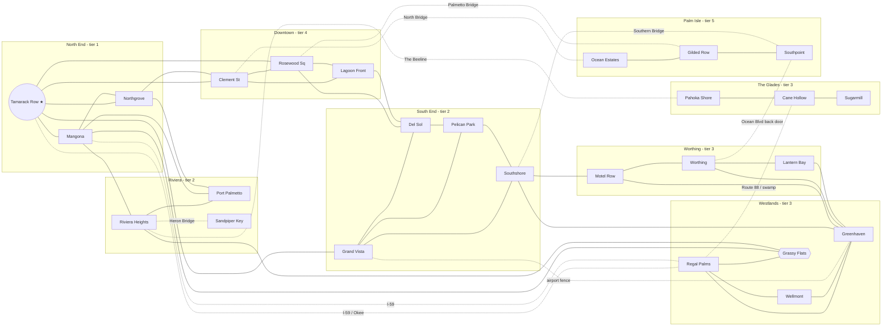

# Map proposal: "Palm County" (issue #35)

**Status: proposal only (rev 4: game-style map, airport made neutral).** No gameplay code or
content data has changed.

- **Game-style map:** [`west_palm_map.svg`](west_palm_map.svg) (preview:
  [`west_palm_map.png`](west_palm_map.png)). It uses the fictional highway names, shows
  `grassy_flats` as a district, and draws PCI Airport as a neutral zone with a buyable Hangar.
- **Schematic:** [`west_palm_wireframe.svg`](west_palm_wireframe.svg) is the rev 2 drawing, kept
  as a reference. It still uses the real highway names (I-95, Turnpike, Route 80/98/7).

This doc is the source of truth for the [decisions](#decisions) below.

The world is based on West Palm Beach and Palm Beach County, FL, compressed to game scale. Every
name is fictional but sounds like a real place, and no business or venue is trademarked. Its
structure follows the turf hierarchy from #24: **8 areas → 26 districts → 1 safehouse each**. That
is 25 turf districts plus 1 special district, the preserve. PCI Airport, the swamp, the
county-line strip and the water stay neutral.

Rev 2 follows the user's reference maps (an illustrated neighborhood map, a county road map and two
WPB street maps) more closely:

- **I-59 bends northwest above downtown.** It runs close to the coast through the south and swings
  inland past Mangonia toward Riviera Beach. The State Pike stays far to the west.
- **The lake chain** (Lake Mangona to the north, Clear Lake to the south) sits between I-59 and
  downtown. Lakes Blvd passes between the two lakes.
- **PCI Airport** hugs the west side of I-59, south of downtown, between Belvedere Rd and Southern
  Blvd. It's no longer out in the suburbs.
- **Palm Isle** is a long, thin barrier island along the whole coast, from the inlet down past
  Worthing. Palm Inlet and Peanut Key are at the north end, by the port.
- **The lagoon-side neighborhoods run north to south** like the real ones: Riviera → Northwood →
  Downtown/Waterfront → El Cid → Flamingo Park (with Grandview Heights inland) → South End → Lake
  Worth Beach → Lantana. The illustrated map draws Lake Worth Beach near the inlet, but that's
  stylized; the road maps put it south of WPB, and so does this map.

## Layout at a glance

From west to east, the map is built in vertical bands, like the real county:

`Lake Okee | The Glades (cane) | Loxahatchee swamp | Westlands (suburbs) | I-59 + lake chain | old WPB neighborhoods | Lagoon | Palm Isle / Sandpiper Key | Atlantic`

- **N–S spines:** the State Pike (far west), Military Trail, I-59 (bends NW above downtown), the
  commuter rail, Dixie Hwy, Lagoon Dr (waterfront), Ocean Blvd (island), and Route 89 along the lake.
- **E–W arteries, north to south:** Heron Blvd, Lakes Blvd, Okee Blvd (motor mile, ends at the
  Palmetto Bridge), Belvedere Rd (broken by the airport), Southern Blvd / Route 88 (the only road to
  the Glades besides the Beeline), Forest Blvd, Worthing Rd and Lantern Rd.
- **Highway names are fictionalized** (decision 3):

  | Real | Game |
  |---|---|
  | I-95 | I-59 |
  | Florida's Turnpike | State Pike |
  | SR 80 (Southern Blvd west) | Route 88 |
  | US 98 / SR 715 (along the lake) | Route 89 |
  | SR 7 | Route 17 |
  | Beeline Hwy (SR 710) | The Beeline |

- **The Beeline:** a diagonal highway from Riviera, northwest across the preserve and swamp, to
  Pahoka Shore. It's the smuggler's back road.
- **Bridges:** 6 drawbridges cross the lagoon (Heron, North, Palmetto, Southern, Worthing, Lantern).
  Palm Isle is reached directly by 3 of them, plus a back door along Ocean Blvd from Worthing Beach.
  No bridge crosses Palm Inlet between Sandpiper Key and Palm Isle.
- **Water:** Lake Worth Lagoon (Intracoastal), the Atlantic, Palm Inlet, Peanut Key, Lake Mangona,
  Clear Lake, the Fifty-One Canal (from the lake to the lagoon, south of Southern Blvd), the C-17 and
  E-4 canals, the Wellmont grid canals, the cane-field ditches and the Levee rim along Lake Okee.

## Areas and districts

The tier is the suggested progression step (1 = first).

| Area (tier) | District id | Name (inspired by) | Flavor | Suggested safehouse |
|---|---|---|---|---|
| **North End** (1) | `tamarack_row` ★ start | Tamarack Row (Tamarind Ave / Historic Northwest) | Shotgun houses between Clear Lake and the tracks, corner stores, the first trap house | Boarded duplex by the tracks |
| | `northgrove` | Northgrove (Northwood) | Faded arts strip, historic bungalows, hospital | Bungalow off the arts strip |
| | `mangona` | Mangona (Mangonia Park) | Light industry and chop shops around Lake Mangona, wedged against I-59 | Chop-shop yard by the lake |
| **Riviera** (2) | `riviera_heights` | Riviera Heights (Riviera Beach) | Tough beach town, power plant stacks | Bodega back room |
| | `port_palmetto` | Port Palmetto (Port of Palm Beach) | Container cranes facing the inlet, warehouses, smuggling | Container-yard office |
| | `sandpiper_key` | Sandpiper Key (Singer Island) | Condo towers, marinas, the inlet | Condo-tower unit |
| **South End** (2) | `grand_vista` | Grand Vista (Grandview Heights) | Historic homes between the tracks and the airport fence | Craftsman house near the runway |
| | `del_sol` | Del Sol (El Cid) | Waterfront historic district, art museum, old money in decline | Mediterranean-revival villa |
| | `pelican_park` | Pelican Park (Flamingo Park) | Palm-lined residential streets, Dixie Hwy shops | Garage apartment |
| | `southshore` | Southshore (South End) | Waterfront marinas, Southern Blvd bridge | Marina bait shop |
| **Worthing** (3) | `motel_row` | Motel Row (Dixie Hwy south / Lake Clarke) | Motels, pawn shops, check cashing | No-tell motel |
| | `worthing` | Worthing + Worthing Beach (Lake Worth Beach) | Bars, a bohemian downtown, the pier and casino hall across the bridge | Upstairs at a pawn shop |
| | `lantern_bay` | Lantern Bay (Lantana) | Boatyards, a small airfield, quiet streets | Boatyard shed |
| **Westlands** (3) | `regal_palms` | Regal Palms (Royal Palm Beach + the Okeechobee Blvd corridor) | Car dealers on the motor mile, strip malls, fairgrounds | Car dealer's back lot |
| | `wellmont` | Wellmont (Wellington) | Gated communities, polo and equestrian grounds, canals | Horse-farm barn |
| | `greenhaven` | Greenhaven (Greenacres / Palm Springs) | Apartments, stucco strip malls, county lockup by the airport | Check-cashing back office |
| | `grassy_flats` (special) | Grassy Flats Preserve (Grassy Waters) | Wetland, water-supply works, lookout tower, body dumps. Light turf, mostly a smuggling and stash zone | Ranger cabin by the tower |
| **The Glades** (3) | `pahoka_shore` | Pahoka Shore (Pahokee) | The Levee, fish camps, the lake | Fish camp on the levee |
| | `cane_hollow` | Cane Hollow (Belle Glade) | Sugar-town projects, cane fires | Project block on Main |
| | `sugarmill` | Sugarmill (South Bay mill country) | Mill smokestacks, airstrip, remote labs and plug drops | Airstrip hangar |
| **Downtown** (4) | `clement_street` | Clement Street (Clematis St) | Nightlife strip, fountain, police HQ | Loft above a dead nightclub |
| | `rosewood_square` | Rosewood Square (Rosemary Square) | Open-air mall, offices, banks | Parking-garage penthouse |
| | `lagoon_front` | Lagoon Front (WPB Waterfront / Flagler Dr) | Marina, amphitheater, high-rise condos | Houseboat at the marina |
| **Palm Isle** (5) | `ocean_estates` | Ocean Estates (north Palm Beach estates) | Mansions to rob, the Breakwater hotel | Gated mansion |
| | `gilded_row` | Gilded Row (Worth Ave-style) | Luxury shopping row, jewelers, galleries | Boutique penthouse |
| | `southpoint` | Southpoint (south Palm Beach estates) | Waterfront estates with private docks | Estate with a dock |

The preserve is a capturable special district (decision 6). It sits in Westlands because it
borders it, but it doesn't count toward the area's tier gating. The neutral zones that can't be
captured and have no gang owner are **PCI Airport**, the **Loxahatchee swamp**, the county-line
strip ("the Gardens", reserved for expansion) and the water.

**PCI Airport (neutral zone, PBI).** Runways, cargo terminals and rental lots against I-59, south
of downtown. Nobody owns it, so it can't be captured. It holds a **buyable Hangar** property that
works like the businesses in #36: you buy it, and it becomes a vehicle-storage and unlock spot.
Private jets and planes can be added there later; flying is out of scope for now. Cargo jobs and
plane-theft missions can still start here.

Solid lines are shared land borders. Dotted lines are road, bridge or highway links. Hexagons are
special districts. PCI Airport is neutral, so it isn't in the graph; it sits between Regal Palms,
Greenhaven, Grand Vista and Tamarack Row.

## Scale and drive times

- **Game space:** 6.0 km (W–E) × 4.8 km (N–S). 1 px in the SVG = 5 m, so 1 km = 200 px.
- **The coast** (lagoon to the State Pike, Riviera to Lantana) is about **1:5** of real
  (~15 × 24 km real → ~3 × 4.4 km game). This keeps the layout recognisable.
- **The Glades and the swamp** are about **1:30** (~60 km real → ~1.6 km game). It's a "long drive
  out" feel without the empty kilometers: the swamp band is a causeway (Twenty Mile Bend) with
  nothing to do on it.
- **District size:** ~400–1,100 m per side in the suburbs and Glades. The old WPB neighborhoods are
  smaller and denser: Downtown, South End and Worthing districts are ~250–600 m. For reference,
  today's generated grid is 9 × 62 m blocks ≈ 570 m for the **whole city**. At the current
  `block_size` + `road_width` (62 m pitch), a typical coastal district is ~4–10 blocks per side.

Target drive times assume a tuned car at ~30 m/s (108 km/h) on highways and ~18 m/s on streets.
`vehicle.gd` has no top speed cap today, so these are tuning targets.

| Trip | Distance | Target |
|---|---|---|
| Tamarack Row → PCI Airport | ~0.5 km | ~30 s |
| Tamarack Row → Clement St | ~0.6 km | ~30 s |
| Downtown → Palm Isle (Palmetto Bridge) | ~0.6 km | ~30 s |
| Tamarack Row → Port Palmetto | ~1.5 km | ~1 min |
| Tamarack Row → Worthing (I-59) | ~1.7 km | ~1 min |
| Downtown → Wellmont | ~2.6 km | ~1½ min |
| Riviera Heights → Lantern Bay (I-59, end to end) | ~4.4 km | ~2½ min |
| Downtown → Cane Hollow (Okee/Southern/Route 88) | ~4.8 km | ~3 min |
| Riviera Heights → Pahoka Shore (the Beeline) | ~4 km | ~2½ min |

That's in line with Saints Row 2's Stilwater, where a full crossing takes ~3–4 minutes.

## Progression: from the gutter to the island

1. **North End** (start: Tamarack Row, between Clear Lake and the tracks, right next to downtown).
   You begin on one corner, and the first trap house sits by the tracks. Mangona's chop shops give
   you early cars. The Palm Isle bridges are open from the start, but the island runs at maximum
   police heat (decision 4), so going there early is a death wish rather than a locked door.
2. **Riviera and South End** (in either order). The port opens smuggling and boat jobs. The South
   End's historic streets (Grand Vista, Del Sol, Pelican Park, Southshore) have fronts and the art
   museum. Capturing Riviera opens the Beeline.
3. **Worthing, Westlands and The Glades.** The money and supply-chain tier. Pawn shops, motels and
   the pier in Worthing. Car dealers on the motor mile and gated-community robberies in the suburbs.
   Remote labs, plug meets and airstrip drops in the Glades. **The Glades are gated by the plug
   storyline** (Smokey / El Primo, #27, decision 5). Route 88 and the Beeline are drivable, but its
   districts, labs and plug meets don't open until the plug story reaches them. The preserve can
   be taken any time after the North End, and the airport Hangar can be bought once you can
   afford it.
4. **Downtown.** High heat, banks, nightlife fronts and police HQ. Holding it lowers the police
   presence on the Palm Isle bridges.
5. **Palm Isle.** The finale: the hardest heat, with police posted on the bridges and the island,
   plus mansion heists, Gilded Row jewelers and the Breakwater.

Boats are out of scope for now (decision 7). The lagoon, inlet and canals keep their shape so boats
can be added later, and every key point stays reachable by road.

## Landmarks

| # | Landmark | District | Gameplay hook |
|---|---|---|---|
| 1 | Port Palmetto container cranes | Port Palmetto | Smuggling, climb and snipe spot |
| 2 | Peanut Key Cold War bunker | Lagoon (neutral) | Hidden stash or a mission |
| 3 | Palm Inlet jetties | Inlet | Boat route out to sea |
| 4 | Riviera power plant stacks | Riviera Heights | Skyline marker for the north |
| 5 | Sandpiper Key condo towers | Sandpiper Key | Rooftop chases |
| 6 | Rosewood Square open-air mall | Rosewood Square | Robbery, fronts |
| 7 | Clement St fountain and waterfront | Clement Street | Nightlife hub |
| 8 | Lagoon Front marina and amphitheater | Lagoon Front | Boats, concerts |
| 9 | The Breakwater (grand oceanfront hotel) | Ocean Estates | Late-game heist |
| 10 | Gilded Row luxury shops | Gilded Row | Jewel heists |
| 11 | Worthing pier, casino hall and boardwalk | Worthing Beach | Hangout, deals |
| 12 | PCI Airport and the Hangar (next to I-59) | PCI Airport (neutral zone) | Buyable Hangar (vehicle storage, future jets), cargo jobs |
| 13 | County lockup | Greenhaven, by the airport | Respawn after a bust |
| 14 | Northgrove hospital | Northgrove | Respawn after getting wasted |
| 15 | Police HQ | Clement Street | Heat center |
| 16 | Tamarack commuter-rail station | Tamarack Row | Train / fast travel later |
| 17 | County fairgrounds | Regal Palms | Events, races |
| 18 | Lion Ranch drive-through safari | Swamp edge | Chaos set piece |
| 19 | Wellmont polo and equestrian grounds | Wellmont | Rich targets |
| 20 | Sugar mill smokestacks | Sugarmill | Western skyline marker |
| 21 | Glades airstrip | Sugarmill | Crop dusters, product drops |
| 22 | The Levee and fish camp | Pahoka Shore | Lake views, boat stash |
| 23 | Grassy Flats lookout tower | Grassy Flats (special) | Vista, body dumps |
| 24 | Del Sol art museum | Del Sol | Art heist |

## Fit with existing systems (for the follow-up, not done here)

- This adds 8 areas (`north_end`, `riviera`, `south_end`, `worthing`, `westlands`, `glades`,
  `downtown`, `palm_isle`) and 26 districts (25 turf districts plus `grassy_flats`), and a neutral PCI Airport zone with a Hangar property
  to replace today's 3 areas and 9 districts in
  `data/areas` and `data/districts`. Existing ids like `the_bottoms` and `riverside` would be
  retired or renamed.
- `DistrictData.grid_origin` only describes a square grid, so authored, uneven districts need a
  boundary (a polygon or a list of rects) and a safehouse position. Several coastal districts have
  a slanted west edge along I-59.
- The existing `LocationDef` placements (trap house, lab, plug meets) map onto the new districts
  like this: the trap house goes to Tamarack Row, the coke lab to Sugarmill or Cane Hollow, and the
  plug meets to Pahoka Shore and Port Palmetto.

## Decisions

These were the 8 open questions from rev 1 and rev 2. The user answered them on 2026-11-24.

1. **Scale:** the full 6 × 4.8 km world is the target for the first authored pass. It can grow
   bigger if it needs to; it shouldn't start at half scale.
2. **District count:** keep all 25 turf districts; don't collapse them. With decision 6, the total
   is 26 (revised: see decision 6).
3. **Road naming:** fictionalize the highway names (I-59, State Pike, Route 88/89/17). See the table
   in [Layout at a glance](#layout-at-a-glance).
4. **Palm Isle gating:** the bridges stay open. The island has heavy heat and a strong police
   presence instead of a hard gate.
5. **The Glades:** gated by the plug storyline (#27).
6. **Airport and preserve:** Grassy Flats Preserve becomes a capturable special district,
   `grassy_flats`. **Revised:** PCI Airport is a **neutral zone**, not a district. It can't be
   captured and has no gang owner. It holds a buyable **Hangar** property (like the businesses in #36)
   for vehicle storage and unlocks, with private jets and planes coming later. Flying is out of scope
   for now.
7. **Boats:** later. The water layout stays boat-ready, but every route works by road.
8. **North county ("the Gardens"):** reserved for a later expansion. The map closes at the county
   line for now.
