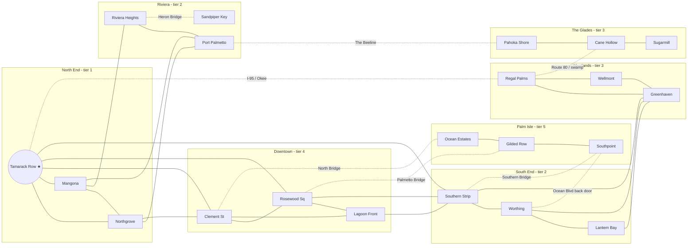

# Map proposal: "Palm County" (issue #35)

**Status: proposal only.** No gameplay code or content data has changed. The wireframe is
[`west_palm_wireframe.svg`](west_palm_wireframe.svg). Open it in a browser.

The world is based on West Palm Beach and Palm Beach County, FL, compressed to game scale. Every
name is fictional but sounds like a real place, and no business or venue is trademarked. Its
structure follows the turf hierarchy from #24: **7 areas → 21 districts → 1 safehouse each**, plus
neutral zones that can't be captured.

## Layout at a glance

From west to east, the map is built in vertical bands, like the real county:

`Lake Okee | The Glades (cane) | Loxahatchee swamp | Westlands (suburbs) | I-95 | old coastal towns | Lagoon | Palm Isle / Sandpiper Key | Atlantic`

- **N–S spines:** the State Turnpike (west), I-95 (center), Dixie Hwy, Lagoon Dr (waterfront), Ocean Blvd (island), and Route 98 along the lake.
- **E–W arteries:** Heron Blvd, Lakes Blvd, Okee Blvd (motor mile), Southern Blvd / Route 80 (the only road to the Glades besides the Beeline), Forest Blvd, Worthing Rd and Lantern Rd.
- **The Beeline:** a diagonal highway from Port Palmetto, northwest across the preserve and swamp, to Pahoka Shore. It's the smuggler's back road.
- **Bridges:** 6 drawbridges cross the lagoon (Heron, North, Palmetto, Southern, Worthing, Lantern). Palm Isle is reached directly by 3 of them, plus a back door along Ocean Blvd from Worthing Beach. Palm Inlet separates Sandpiper Key from Palm Isle, and no bridge crosses it.
- **Water:** Lake Worth Lagoon (Intracoastal), the Atlantic, Palm Inlet, Peanut Key, Lake Mangona, Clear Lake, the Fifty-One Canal (along Southern Blvd from the lake to the lagoon), the C-17 and E-4 canals, the Wellmont grid canals, the cane-field ditches and the Levee rim along Lake Okee.

## Areas and districts

The tier is the suggested progression step (1 = first).

| Area (tier) | District id | Name (inspired by) | Flavor | Suggested safehouse |
|---|---|---|---|---|
| **North End** (1) | `tamarack_row` ★ start | Tamarack Row (Tamarind Ave corridor) | Shotgun houses along the commuter rail, corner stores, the first trap house | Boarded duplex by the tracks |
| | `northgrove` | Northgrove (Northwood) | Faded arts strip, bungalows, hospital | Bungalow off the arts strip |
| | `mangona` | Mangona (Mangonia Park) | Light industry, chop shops, Lake Mangona | Chop-shop yard |
| **Riviera** (2) | `riviera_heights` | Riviera Heights (Riviera Beach) | Tough beach town, power plant stacks | Bodega back room |
| | `port_palmetto` | Port Palmetto (Port of Palm Beach) | Container cranes, warehouses, smuggling | Container-yard office |
| | `sandpiper_key` | Sandpiper Key (Singer Island) | Condo towers, marinas, inlet | Condo-tower unit |
| **South End** (2) | `southern_strip` | Southern Strip (Southern Blvd) | Motels, pawn shops, check cashing | No-tell motel |
| | `worthing` | Worthing + Worthing Beach (Lake Worth Beach) | Bars, a bohemian downtown, the pier and casino hall on the beach | Upstairs at a pawn shop |
| | `lantern_bay` | Lantern Bay (Lantana) | Boatyards, a small airfield vibe, quiet streets | Boatyard shed |
| **Westlands** (3) | `regal_palms` | Regal Palms (Royal Palm Beach + Okeechobee Blvd) | Car dealers on the motor mile, strip malls, fairgrounds | Car dealer's back lot |
| | `wellmont` | Wellmont (Wellington) | Gated communities, polo and equestrian grounds, canals | Horse-farm barn |
| | `greenhaven` | Greenhaven (Greenacres) | Apartments, stucco strip malls, the county lockup nearby | Check-cashing back office |
| **The Glades** (3) | `pahoka_shore` | Pahoka Shore (Pahokee) | The Levee, fish camps, the lake | Fish camp on the levee |
| | `cane_hollow` | Cane Hollow (Belle Glade) | Sugar-town projects, cane fires | Project block on Main |
| | `sugarmill` | Sugarmill (South Bay mill country) | Mill smokestacks, airstrip, remote labs and plug drops | Airstrip hangar |
| **Downtown** (4) | `clement_street` | Clement Street (Clematis St) | Nightlife strip, fountain, police HQ | Loft above a dead nightclub |
| | `rosewood_square` | Rosewood Square (Rosemary Square) | Open-air mall, offices, banks | Parking-garage penthouse |
| | `lagoon_front` | Lagoon Front (Flagler Dr waterfront) | Marina, amphitheater, high-rise condos | Houseboat at the marina |
| **Palm Isle** (5) | `ocean_estates` | Ocean Estates (north Palm Beach estates) | Mansions to rob, the Breakwater hotel | Gated mansion |
| | `gilded_row` | Gilded Row (Worth Ave-style) | Luxury shopping row, jewelers, galleries | Boutique penthouse |
| | `southpoint` | Southpoint (south Palm Beach estates) | Waterfront estates with private docks | Estate with a dock |

The neutral zones can't be captured: the **PCI Airport**, the **Grassy Flats Preserve**, the
**Loxahatchee swamp**, the county-line strip and the water.

Solid lines are shared land borders. Dotted lines are road, bridge or highway links.

## Scale and drive times

- **Game space:** 6.0 km (W–E) × 4.8 km (N–S). 1 px in the SVG = 5 m, so 1 km = 200 px.
- **The coast** (lagoon to the Turnpike, Riviera to Lantana) is about **1:5** of real
  (~15 × 24 km real → ~3 × 4.4 km game). This keeps the layout recognisable.
- **The Glades and the swamp** are about **1:30** (~60 km real → ~1.6 km game). It's a "long drive
  out" feel without the empty kilometers: the swamp band is a causeway (Twenty Mile Bend) with
  nothing to do on it.
- **District size:** ~400–1,100 m per side on the mainland (Downtown districts are deliberately
  small and dense, ~250 × 500 m). For reference, today's generated grid is 9 × 62 m blocks ≈ 570 m
  for the **whole city**. At the current `block_size` + `road_width` (62 m pitch), a typical district
  is ~8–15 blocks per side.

Target drive times assume a tuned car at ~30 m/s (108 km/h) on highways and ~18 m/s on streets.
`vehicle.gd` has no top speed cap today, so these are tuning targets.

| Trip | Distance | Target |
|---|---|---|
| Tamarack Row → Clement St | ~0.6 km | ~30 s |
| Downtown → Palm Isle (Palmetto Bridge) | ~0.6 km | ~30 s |
| Tamarack Row → Port Palmetto | ~1.4 km | ~1 min |
| Tamarack Row → Worthing (I-95) | ~1.6 km | ~1 min |
| Downtown → Wellmont | ~2.6 km | ~1½ min |
| Riviera Heights → Lantern Bay (I-95, end to end) | ~4.4 km | ~2½ min |
| Downtown → Cane Hollow (Okee/Southern/Route 80) | ~4.8 km | ~3 min |
| Port Palmetto → Pahoka Shore (the Beeline) | ~4 km | ~2½ min |

That's in line with Saints Row 2's Stilwater, where a full crossing takes ~3–4 minutes.

## Progression: from the gutter to the island

1. **North End** (start: Tamarack Row). You begin on one corner, and the first trap house sits by the
   tracks. Mangona's chop shops give you early cars. The bridges to Palm Isle are raised or
   police-gated.
2. **Riviera and South End** (in either order). The port opens smuggling and boat jobs. The South
   End has pawn and check-cashing fronts and the Worthing pier. Capturing Port Palmetto opens the
   Beeline.
3. **Westlands and The Glades.** The money and supply-chain tier. Car dealers on the motor mile and
   gated-community robberies in the suburbs. Remote labs, plug meets and airstrip drops in the
   Glades. The Glades could open earlier through the plug storyline (Smokey / El Primo, #27).
4. **Downtown.** High heat, banks, nightlife fronts and police HQ. Holding it lowers the bridge gates.
5. **Palm Isle.** The finale: the hardest heat, mansion heists, Gilded Row jewelers and the Breakwater.

## Landmarks

| # | Landmark | District | Gameplay hook |
|---|---|---|---|
| 1 | Port Palmetto container cranes | Port Palmetto | Smuggling, climb and snipe spot |
| 2 | Peanut Key Cold War bunker | Lagoon (neutral) | Hidden stash or a mission |
| 3 | Palm Inlet jetties | Inlet | Boat route out to sea |
| 4 | Riviera power plant stacks | Riviera Heights | Skyline marker for the north |
| 5 | Sandpiper Key condo towers | Sandpiper Key | Rooftop chases |
| 6 | Rosewood Square open-air mall | Rosewood Square | Robbery, fronts |
| 7 | Clement St fountain and waterfront | Clement Street | Nightlife hub |
| 8 | Lagoon Front marina and amphitheater | Lagoon Front | Boats, concerts |
| 9 | The Breakwater (grand oceanfront hotel) | Ocean Estates | Late-game heist |
| 10 | Gilded Row luxury shops | Gilded Row | Jewel heists |
| 11 | Worthing pier, casino hall and boardwalk | Worthing Beach | Hangout, deals |
| 12 | PCI Airport | Neutral | Plane theft, cargo jobs |
| 13 | County lockup | Greenhaven edge | Respawn after a bust |
| 14 | Northgrove hospital | Northgrove | Respawn after getting wasted |
| 15 | Police HQ | Clement Street | Heat center |
| 16 | Tamarack commuter-rail station | Tamarack Row | Train / fast travel later |
| 17 | County fairgrounds | Regal Palms | Events, races |
| 18 | Lion Ranch drive-through safari | Swamp edge | Chaos set piece |
| 19 | Wellmont polo and equestrian grounds | Wellmont | Rich targets |
| 20 | Sugar mill smokestacks | Sugarmill | Western skyline marker |
| 21 | Glades airstrip | Sugarmill | Crop dusters, product drops |
| 22 | The Levee and fish camp | Pahoka Shore | Lake views, boat stash |
| 23 | Grassy Flats lookout tower | Preserve | Vista, body dumps |

## Fit with existing systems (for the follow-up, not done here)

- This adds 7 areas (`north_end`, `riviera`, `south_end`, `westlands`, `glades`, `downtown`,
  `palm_isle`) and 21 districts to replace today's 3 areas and 9 districts in `data/areas` and
  `data/districts`. Existing ids like `the_bottoms` and `riverside` would be retired or renamed.
- `DistrictData.grid_origin` only describes a square grid, so authored, uneven districts need a
  boundary (a polygon or a list of rects) and a safehouse position.
- The existing `LocationDef` placements (trap house, lab, plug meets) map onto the new districts
  like this: the trap house goes to Tamarack Row, the coke lab to Sugarmill or Cane Hollow, and the
  plug meets to Pahoka Shore and Port Palmetto.

## Open questions

1. **Scale:** is a 6 × 4.8 km world right for the first authored pass? Or should the greybox start
   at half scale (~3 × 2.4 km) and grow later?
2. **District count:** is 21 too many for now? One option is to collapse each area to 2 districts
   at first (14 total) and keep the rest as sub-zones.
3. **Road naming:** keep real public highway numbers (I-95, Route 80, Route 98, Route 7) or rename
   them all (for example "the 95")? Street and venue names are already fictional.
4. **Gating:** should the Palm Isle bridges be physically raised until Downtown is held, or open
   but with heavy police heat?
5. **The Glades:** is it reachable from the start (free roam) with labs gated by the plug storyline,
   or locked behind a story beat?
6. **Neutral zones:** should the airport and the preserve stay uncapturable, or become special
   districts (for example "the airport" as a cargo-heist district)?
7. **Water traversal:** are boats in scope? The lagoon, inlet and canals are designed as boat
   routes, but every key point is also reachable by road.
8. **North expansion:** the county line at the top ("the Gardens") is reserved for a later
   expansion. Is that wanted, or should the map close there?
